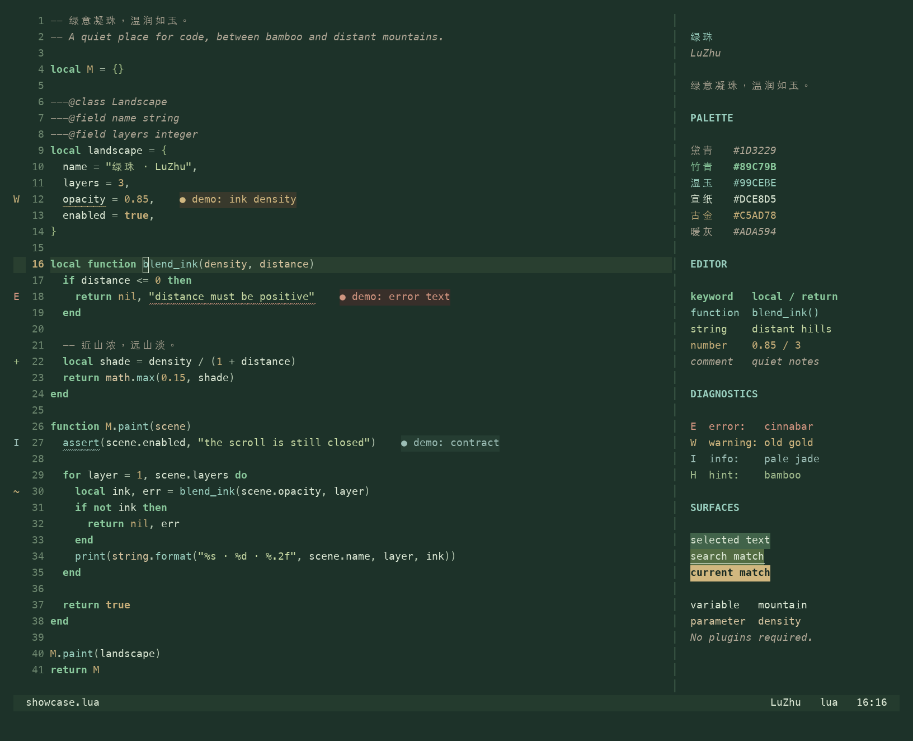

# 绿珠 · LuZhu.nvim

> 红树摇歌扇，绿珠飘舞衣。

> 君不见绿珠潭水流东海，绿珠红粉沉光彩。

绿珠，既取中国古代美人之名，也寄寓绿意凝成珍宝的温润与珍贵。以低饱和松绿、温玉与宣纸色，呈现安静清晰的 Neovim 深色主题。



需要 **Neovim 0.10+** 与支持真彩色的终端，无插件依赖。

- 注释暖灰斜体，变量明亮，关键字竹青加粗。
- 支持 Treesitter、LSP 语义高亮、诊断、diff 与终端色。
- 适配 Telescope、nvim-cmp、blink.cmp、Neo-tree、nvim-tree、which-key、gitsigns 等插件。
- 支持透明背景、非活动窗口变暗与高亮覆盖。

## 安装

使用 lazy.nvim：

```lua
{
  "wsgggws/LuZhu.nvim",
  lazy = false,
  priority = 1000,
  config = function()
    vim.cmd.colorscheme("luzhu")
  end,
}
```

使用 LazyVim 时，注册主题插件，并设置：

```lua
return {
  { "wsgggws/LuZhu.nvim", lazy = true },
  { "LazyVim/LazyVim", opts = { colorscheme = "luzhu" } },
}
```

本地安装可将仓库名替换为 `dir = vim.fn.expand("~/github/LuZhu.nvim")`。
安装后也可执行 `:colorscheme luzhu`。主题会自动启用 `termguicolors`。

## 配置

`setup()` 可省略；自定义时在加载主题之前调用：

```lua
require("luzhu").setup({
  transparent = false,
  dim_inactive = false,
  terminal_colors = true,
  styles = {
    comments = { italic = true },
    keywords = { bold = true },
  },
  palette = {},
  highlights = {},
})
vim.cmd.colorscheme("luzhu")
```

例如关闭注释斜体、覆盖高亮：

```lua
require("luzhu").setup({
  styles = { comments = { italic = false } },
  highlights = function(p)
    return { CursorLineNr = { fg = p.jade, bold = true } }
  end,
})
```

修改配置后重新执行 `:colorscheme luzhu`。完整选项见 `:help luzhu`。

## 色彩

| 角色          | 色值                  |
| ------------- | --------------------- |
| 背景 / 正文   | `#1D3229` / `#DCE8D5` |
| 注释 / 关键字 | `#ADA594` / `#89C79B` |
| 函数 / 参数   | `#99CEBE` / `#D7C5A0` |
| 字符串 / 数字 | `#C6D8A3` / `#C5AD78` |

松绿背景与竹青关键字强化青绿气息；明亮变量、暖灰注释、冷玉函数与浅沙参数拉开层级，字体样式作为辅助。完整色板见 [palette.lua](lua/luzhu/palette.lua)。

## 其他配色

[extras/](extras/README.md) 提供 WezTerm、tmux、fzf、bat、Git diff（delta）、Alfred 与 slides 的同色板主题文件，随色板同步更新。导入与重载方法见各工具说明。已配置本机统一切换函数时，执行 `switch_all_theme luzhu`；更新配色文件后执行 `switch_all_theme luzhu --refresh`。个人安装与切换脚本在各自配置目录维护。

## 预览

```sh
nvim -u scripts/preview.lua
```

开发与截图方法见 [CONTRIBUTING.md](CONTRIBUTING.md)。

## 许可

[MIT](LICENSE)
